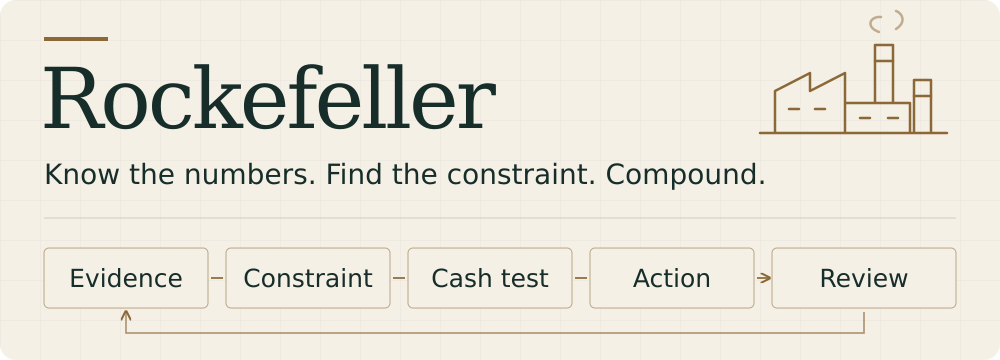

# Rockefeller



An agent-agnostic business strategy skill focused on operating economics, cash resilience, and disciplined growth. Built on the open [Agent Skills format](https://agentskills.io/specification), it can be used by Claude Code, Codex, and other agents that load `SKILL.md` instructions.

Rockefeller uses a modern adaptation of John D. Rockefeller's emphasis on exact accounting, operating efficiency, patient capital, and compounding advantages. It helps turn business data into a priority, a defensible decision, and an execution plan.

## When to use it

- Revenue is growing, but cash or contribution profit is falling.
- You need to identify the bottleneck before cutting costs or scaling.
- You need to compare pricing, retention, acquisition payback, and capacity before funding growth.
- A supplier offers a discount in exchange for a larger commitment.
- You are comparing outsourcing with building or buying a capability.
- You need to assess borrowing, reinvestment, an acquisition, or a partnership.
- You need to validate paid demand before hiring or building a larger product.
- You need to compare price/package changes or allocate limited labor and machine time.
- You want to revisit a saved decision using actual results.

Discovery is optional. For an uncertain business idea, the skill can work through customer evidence and challenge the proposed solution. A fully specified decision gets a direct answer. Specialist references are loaded only when relevant.

The skill is designed for operating business decisions. Historical research about Rockefeller and personal portfolio advice are outside its intended scope.

## Install

Run installation commands where your agent runs. In a remote development setup, use the development server; for an agent running locally on your Mac, use the Mac.

### Choose your agent with the skills CLI

With Node.js available, run this in the project where you want the skill:

```bash
npx skills add AyushRajSinghParihar/rockefeller --skill rockefeller
```

The installer lets you choose supported agents. To target one or several directly:

```bash
# Claude Code
npx skills add AyushRajSinghParihar/rockefeller --skill rockefeller --agent claude-code

# Codex, Cursor, and GitHub Copilot
npx skills add AyushRajSinghParihar/rockefeller --skill rockefeller --agent codex cursor github-copilot
```

Add `--global` for a user-level installation. See the [skills CLI documentation](https://github.com/vercel-labs/skills) for supported agents and options. Node.js is needed for this installer, not for the skill itself.

### Manual installation

Choose one installation method. No package manager is required to clone the skill directly.

**Claude Code — personal installation:**

```bash
mkdir -p "$HOME/.claude/skills"
git clone https://github.com/AyushRajSinghParihar/rockefeller.git "$HOME/.claude/skills/rockefeller"
```

For a project installation, use `.claude/skills/rockefeller/` inside your project. Invoke it with `/rockefeller`, or describe a matching business task. See [Claude Code's skill documentation](https://code.claude.com/docs/en/skills).

**Codex — personal installation:**

```bash
mkdir -p "$HOME/.agents/skills"
git clone https://github.com/AyushRajSinghParihar/rockefeller.git "$HOME/.agents/skills/rockefeller"
```

For a project installation, use `.agents/skills/rockefeller/`. Invoke it with `$rockefeller` or select it through `/skills`. See [Codex's skill documentation](https://learn.chatgpt.com/docs/build-skills).

**Other agents and chat apps:** put the `rockefeller` folder in your agent's documented skill directory, keeping `SKILL.md` at its top level. Use that host's invocation syntax. If native skills are unavailable, attach or paste `SKILL.md` plus the relevant files from `references/` as instructions and ask the agent to follow them. Include the reference text when your app cannot open linked files. This does not add automatic discovery to that host.

The core skill uses standard `name` and `description` metadata and contains no vendor-specific tool calls, model requirements, or CLI commands. `agents/openai.yaml` is optional Codex UI metadata; other hosts do not need it. Installation and automatic selection depend on the host. The examples below use plain language; replace the opening with `/rockefeller` in Claude Code or `$rockefeller` in Codex when you want explicit invocation.

Rockefeller's business analysis workflow is instruction-only and requires no additional packages, API keys, or MCP connections of its own. Live research and analysis of supplied files depend on the tools available to your agent; the skill does not supply accounting data or connect to your accounts. The optional development evaluation runner has separate requirements described below.

## Try it

### Review the business

```text
Use the Rockefeller skill to review my ecommerce business and identify the next priority.
All figures are USD for September 2026:
- Net revenue: $80,000 across 2,000 orders.
- Variable costs: $32,000 product, $10,000 fulfillment, $2,400 payment fees,
  $3,600 returns handling, and $12,000 paid acquisition. No overlap between categories.
- Fixed operating costs: $18,000.
- Unrestricted cash: $35,000. A $25,000 inventory payment is due in two weeks.
- No debt. I want to grow without taking outside equity.
Give a provisional diagnosis, flag the most important missing input,
and recommend the immediate next step.
```

### Evaluate a supplier offer

```text
Use the Rockefeller skill to evaluate a supplier offer. We buy 1,000 units a month
at $20 each, payable after 30 days. The supplier offers $18 per unit
if we prepay for 6,000 units. We have $45,000 of unrestricted cash
and $12,000 of monthly fixed cash costs. Demand fluctuates by 30%.
Compare the savings, cash commitment, and inventory exposure.
Suggest a counteroffer. Keep the answer focused on this decision.
```

### Compare an acquisition with organic growth

```text
Use the Rockefeller skill to compare acquiring a small competitor with growing organically.
Use the attached financial statements and proposed deal terms.
Separate purchase price from total cash required, evaluate the deal without
synergies, and show what changes under a downside case.
Identify missing evidence before recommending a commitment.
```

### Decide whether to fund growth

```text
Use the Rockefeller skill to review a proposed subscription growth investment.
We can acquire 100 customers for $60 each upfront. Each signs a 12-month
contract paying $50 monthly, with $20 monthly variable service costs.
Assume no churn or missed payments during the term. Existing capacity covers
the cohort, with no extra fixed costs or capex. Cash is $200,000 and the
required reserve is $100,000; existing obligations are funded. All USD.
Compare incremental contribution, cash payback, and liquidity.
Recommend whether to fund it and give a monitoring trigger.
```

### Work through an uncertain business idea

```text
Use the Rockefeller skill for business office hours. We have a waitlist but
no paying customers, and are considering a sales hire. Help establish the
buyer, current workaround, strongest demand evidence, and smallest paid
pilot before we commit. Use what I have already told you and keep the
conversation focused on the missing evidence that changes the decision.
```

### Keep a decision portable

```text
Use the Rockefeller skill to save our business context and this supplier
pilot decision as Markdown in this project. Record dated facts, assumptions,
the expected incremental cash effect, and a review trigger. Next month,
read those files, compare actuals with the original forecast, and append
the revised decision while preserving the original prediction.
```

Saving records is optional and follows your requested paths. Plain Markdown can be reused by another agent; the skill needs no memory service. When writing is unavailable, ask for a draft to save yourself.

## A worked decision

Using the supplier-offer inputs above, a concise answer would be:

> **Decline the prepayment offer on the stated cash position.** Buying 6,000 units at $18 requires **$108,000 now**. Compared with $20 per unit, the nominal six-month saving is **$12,000**, but $45,000 cash leaves a **$63,000 funding gap before reserves and other obligations**. The commitment also buys six months of normal demand while demand fluctuates.
>
> Ask for smaller scheduled deliveries and payment after delivery, or a smaller commitment with a documented price tier. Re-evaluate only after actual terms and a dated cash forecast establish affordability and acceptable inventory exposure. A lower unit price alone does not fund the purchase.

This is an edited illustration with independently checked arithmetic, not a verbatim transcript or an independent evaluation case. The same decision contract is covered in [the evaluation cases](evals/cases.jsonl).

## What to provide

Start with the decision, business model, geography, period, and currency. Add the numbers relevant to that decision:

| Decision | Helpful inputs |
| --- | --- |
| Pricing or packaging | Current/proposed prices, pricing metric, costs and demand by segment, fixed-cost changes |
| Capacity allocation | Resource use per unit, available hours/slots, demand caps, committed orders, incremental contribution |
| Decision review | Original dated forecast and assumptions, actual results, sources, period, and cash/accounting basis |
| Operating review | Revenue, units or customers, variable and fixed costs, retention, capacity |
| Growth investment | Pricing, acquisition spending, cohort retention, contribution per active customer, collection timing, available capacity |
| Cash resilience | Unrestricted cash, collections, payment dates, inventory, taxes, debt service, capital spending |
| Supplier negotiation | Delivered cost, purchase volumes, payment terms, service levels, alternatives, commitments |
| Build, buy, or partner | Setup costs, utilization, operating costs, capabilities, working capital, switching costs |
| Acquisition or financing | Financial statements, valuation or loan terms, liabilities, integration costs, downside assumptions |

Use estimates or ranges when exact figures are unavailable, and label them. A narrow decision does not require a complete business dossier. The skill should use what you have, explain uncertainty, and identify the missing information that could change the recommendation.

CSV exports, spreadsheets, and financial statements can be supplied in their existing format. Include the reporting period, currency, and accounting basis. If two files disagree, provide both rather than silently merging them. The skill should preserve the originals, trace important figures to their file and metric or row, and keep decisions conditional where differences remain unresolved. See the synthetic [ledger](evals/fixtures/september-ledger.csv) and [management summary](evals/fixtures/management-summary.csv) for a small worked input pair.

## What you should get

A focused answer should identify the constraint, show relevant arithmetic, recommend an intervention, and explain the cash required, principal downside, and conditions that would change the decision.

A full review also covers market evidence, operating leverage, build/buy/partner options, and the capital plan. It closes with an execution ledger containing actions, proposed owners, deadlines, measurable targets, cash commitments, and stop or review triggers. Questions about one decision should receive a proportionate answer.

Pricing and capacity decisions should identify the threshold or resource constraint that changes the choice, with hypothetical demand labeled clearly. Saved reviews should preserve the original forecast and explain the variance using actual results.

Growth decisions should use retained contribution and cash payback rather than revenue alone. Material investment comparisons should use a common horizon, incremental cash flows, and supported residual values; discounted cash flows apply when timing changes the choice. The skill should explain uncertain inputs instead of inventing a universal hurdle rate or payback benchmark.

Current market, financing, and legal claims need current sources and the relevant jurisdiction. When those cannot be verified, recommendations should remain conditional. The skill supports analysis and drafting; actions such as contacting a supplier or moving funds require authorization for that action.

## Repository

| File | Purpose |
| --- | --- |
| [SKILL.md](SKILL.md) | Agent instructions, financial definitions, decision playbook, and output guidance |
| [references/](references/) | Optional discovery, pricing, capacity, and decision-review walkthroughs |
| [docs/assets/rockefeller-banner.svg](docs/assets/rockefeller-banner.svg) | Original, self-contained README illustration |
| [agents/openai.yaml](agents/openai.yaml) | Optional Codex UI metadata; not required by other hosts |
| [evals/cases.jsonl](evals/cases.jsonl) | Agent-neutral decision cases and financial expectations, including two holdouts |
| [evals/scenarios.jsonl](evals/scenarios.jsonl) | Seven development scenarios plus two holdouts, including real conversations and saved-record review |
| [evals/test_runner.py](evals/test_runner.py) | CLI validation, split selection, safe output paths, and evidence-overwrite checks |
| [evals/activation.jsonl](evals/activation.jsonl) | Six positive and five negative discovery cases |
| [evals/fixtures/](evals/fixtures/) | Synthetic financial exports for evidence reconciliation |
| [evals/run.py](evals/run.py) | Optional runner for isolated Codex evaluation sessions |
| [evals/protocol.md](evals/protocol.md) | Agent-neutral evaluation method plus the optional Codex runner instructions |
| [evals/results.md](evals/results.md) | Dated results, evidence, and limitations |
| [README.md](README.md) | Installation, examples, and contributor guidance |

## Verification and development

On October 21, 2026, the final revision passed **21 behavioral cases and 11 activation checks** in Codex. The baseline passed **20/21 and 11/11**, and a targeted no-skill subset passed **2/3**. The observed improvement was an explicit operating assumption to monitor in a capital approval. These single-sample, manually graded results do not establish general accuracy improvement or statistical reliability. See [the dated results and evidence](evals/results.md#business-workflows--october-21-2026), including the preliminary failure and subsequent full rerun.

The 67 formal case runs included real sequential conversations and a fresh-session review of actual saved documents. A separate read-only check returned an explicitly unsaved draft. The original October 20 results remain in the report with their original dates.

Project installations with skills CLI **1.7.0** accepted Claude Code, Codex, Cursor, and GitHub Copilot; the core, optional UI metadata, and all four references matched the final source. This verifies installation and file integrity. Runtime decision and discovery evidence remains Codex-only; Claude is currently unauthenticated.

The prompts, fixtures, and grading expectations are reusable with any agent. Follow the host-neutral steps in [the protocol](evals/protocol.md) and use your host's installation, invocation, and trace controls. A result from one host does not establish discovery or behavior on another.

The bundled **optional Codex runner** supports single-turn cases, native resumed conversations, and isolated document-writing cases. It requires Python 3.11+, Git, and an authenticated Codex CLI supporting its isolation flags; CLI 0.162.1 was verified. Those are development-tool requirements, not requirements to use Rockefeller in Claude Code or another agent. On servers that provide `agent-run`, use it for heavy evaluation workloads; omit it elsewhere. Results belong outside the checkout; no extra Python packages are required.

Run the runner contract checks with `python3 -m unittest discover -s evals -p 'test_*.py'`.

Follow [the protocol](evals/protocol.md) to snapshot the baseline before editing, run matched comparisons, and grade every expectation using answer/trace evidence. The runner captures outputs and provenance; it does not automatically grade strategic judgment. Activation checks use natural prompts and actual skill-loading traces, separately from explicit invocation. The Codex runner disables connector and browsing access for the synthetic cases; other user/system skills can remain discoverable. Apply equivalent isolation when evaluating another host.

Keep the entrypoint concise and load expanded specialist references selectively. Add a financial helper only when repeated use establishes a stable need; no calculator or mandatory input schema is required by this skill. [OpenAI's authoring advice](https://developers.openai.com/blog/rethinking-skills-and-prompts-for-gpt-6-astra) similarly emphasizes concise, task-specific instructions.

Authoring references checked on October 20, 2026:

- [OpenAI: testing skills with evaluations](https://developers.openai.com/blog/eval-skills) — distinguish activation, outcomes, process, and efficiency.
- [Agent Skills: evaluating skills](https://agentskills.io/skill-creation/evaluating-skills) — compare behavior against concrete expectations and a baseline.
- [Agent Skills: optimizing descriptions](https://agentskills.io/skill-creation/optimizing-descriptions) — evaluate when a skill is selected.
- [Agent Skills specification](https://agentskills.io/specification) — required metadata, optional resources, and progressive disclosure.
- [Anthropic: skill authoring best practices](https://platform.claude.com/docs/en/agents-and-tools/agent-skills/best-practices) — concise guidance, appropriate degrees of freedom, and evaluation-driven iteration.

The discovery, pricing, and decision-review references link their inspirations, including [Garry Tan’s office-hours skill](https://github.com/garrytan/gstack/blob/main/office-hours/SKILL.md) and [Corey Haines’s marketing skills](https://github.com/coreyhaines31/marketingskills). Rockefeller adapts those ideas to operating economics, cash, and portable records. It has no dependency on either package.
